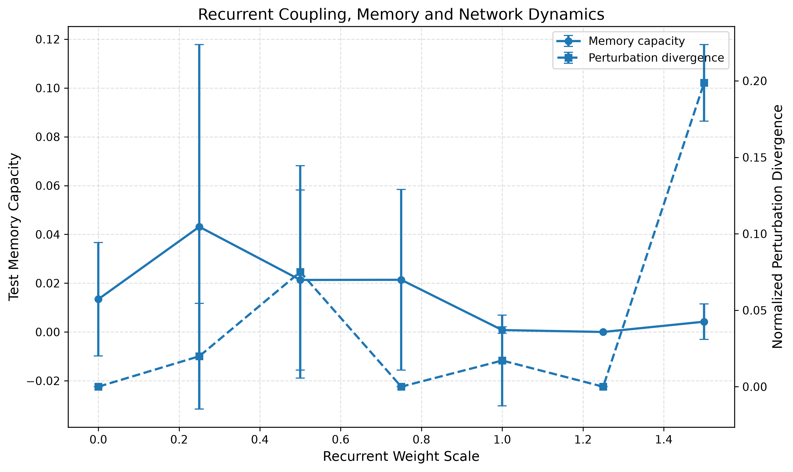

# Edge of Chaos in a Spiking Liquid State Machine

[](https://opensource.org/licenses/MIT)
[](https://www.python.org/)
[](https://brian2.readthedocs.io/)

> Investigating how recurrent coupling strength influences memory performance, perturbation sensitivity, and dynamical behavior in a spiking Liquid State Machine.

---

## Main Result



## Research Question

Is there an optimal recurrent coupling strength at which a spiking reservoir balances dynamical stability, perturbation sensitivity, and computational performance?

This experiment systematically investigates how changing recurrent synaptic weights influences the temporal memory capacity and dynamical behavior of a recurrent LIF network.

## Background

Liquid State Machines use recurrent spiking neural networks to transform temporal input streams into high-dimensional dynamical representations. Maass, Natschläger, and Markram (2002) demonstrated how transient recurrent activity can provide fading memory for time-varying inputs.

Research on recurrent neural networks has also suggested that computational complexity can peak near the transition between ordered and chaotic dynamics (Natschläger et al., 2004).

This project investigates whether a related performance optimum appears in a randomly connected spiking LIF reservoir.

### References

1. Maass, W., Natschläger, T., & Markram, H. (2002). Real-time computing without stable states: A new framework for neural computation based on perturbations. Neural Computation, 14(11), 2531–2560.
   https://doi.org/10.1162/089976602760407955

2. Natschläger, T., Bertschinger, N., & Legenstein, R. (2004). At the Edge of Chaos: Real-time Computations and Self-Organized Criticality in Recurrent Neural Networks.
   https://proceedings.neurips.cc/paper_files/paper/2004/file/f8da71e562ff44a2bc7edf3578c593da-Paper.pdf

---

## Methodology

### Reservoir Architecture

| Parameter | Configuration |
|---|---|
| Neuron model | Leaky Integrate-and-Fire |
| Simulator | Brian2 |
| Network size | 200 neurons |
| Excitatory neurons | 80% |
| Inhibitory neurons | 20% |
| Recurrent connectivity | 10% |
| Membrane time constant | 20 ms |
| Synaptic time constant | 5 ms |
| Refractory period | 5 ms |
| Simulation time step | 0.1 ms |

### Experimental Design

Seven recurrent coupling scales are investigated:

`0.00, 0.25, 0.50, 0.75, 1.00, 1.25, 1.50`

Each condition is repeated across three random seeds.

The same random input, connectivity, and synaptic weight pattern are maintained across coupling conditions within each seed. Only the recurrent weight multiplier changes.

### Performance Measures

**1. Memory Capacity**

A Ridge regression readout reconstructs past input values from the current reservoir state.

The experiment evaluates delays from 1 to 20 time bins using a chronological 60/40 training/testing split.

The reported memory capacity is the sum of positive test-set R² values.

**2. Perturbation Sensitivity**

Two identical reservoirs receive the same input and connectivity, but differ by a small initial membrane-potential perturbation.

The normalized RMS difference between their firing-rate trajectories measures sensitivity to this perturbation.

**3. Mean Firing Rate**

The average neuronal firing rate is measured to characterize network activity across coupling conditions.

---

## Results

The experiment generates:

- `results/per_seed_results.csv`: Individual seed-level measurements.
- `results/summary.csv`: Mean and standard deviation across seeds.
- `figures/main_result.png`: Memory performance and perturbation sensitivity.
- `figures/firing_rate.png`: Population activity across coupling strengths.

The highest observed memory performance is printed automatically after execution.

No numerical result is assumed in advance.

---

## Repository Structure

```text
lsm-04-edge-of-chaos/
│
├── README.md
├── LICENSE
├── requirements.txt
├── .gitignore
│
├── data/
│   └── README.md
│
├── src/
│   ├── __init__.py
│   ├── data.py
│   ├── reservoir.py
│   └── metrics.py
│
├── scripts/
│   └── run_experiment.py
│
├── figures/
│   ├── main_result.png
│   └── firing_rate.png
│
└── results/
    ├── summary.csv
    └── per_seed_results.csv
```

---

## How to Run

### 1. Create and activate the environment

```bash
python3 -m venv .venv
source .venv/bin/activate
```

### 2. Install dependencies

```bash
pip install -r requirements.txt
```

### 3. Run the experiment

```bash
PYTHONPATH=. python3 scripts/run_experiment.py
```

The experiment automatically generates the figures and CSV results.

---

## Limitations

- The experiment uses a relatively small reservoir of 200 neurons.
- Only three random seeds are evaluated.
- Input signals are synthetically generated rather than biological recordings.
- The recurrent coupling sweep covers a finite range of parameters.
- Perturbation sensitivity is not equivalent to a formal Lyapunov exponent.
- An observed memory-performance optimum does not independently establish an edge-of-chaos transition.

Further investigations should explore larger reservoirs, additional coupling strengths, more random seeds, and formal dynamical stability measures.

---

## License

MIT License.

Copyright (c) 2026 Beimnet Essayas Dishole
